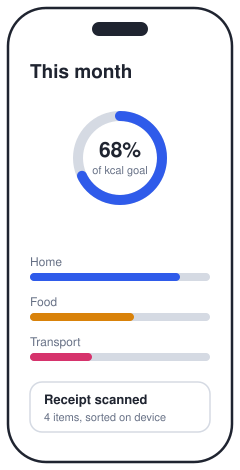

<picture>
  <source media="(prefers-color-scheme: dark)" srcset="assets/hero-dark.svg">
  
</picture>

Hi, I'm Ahmet. I build data and AI systems at Omtera, mostly in Python: workflow engines, data pipelines and tools with a language model inside. What pulls me in is AI that does actual work, like agents that act through real tools, speech models in live conversations, and models small enough to run on a phone. After hours I build apps for myself with SwiftUI.

  <picture>
    <source media="(prefers-color-scheme: dark)" srcset="assets/phone-budget-dark.svg">
    
  </picture>
  &nbsp;&nbsp;
  <picture>
    <source media="(prefers-color-scheme: dark)" srcset="assets/phone-german-dark.svg">
    
  </picture>
  &nbsp;&nbsp;
  <picture>
    <source media="(prefers-color-scheme: dark)" srcset="assets/phone-flights-dark.svg">
    
  </picture>

Say hello on [LinkedIn](https://www.linkedin.com/in/ahmet-hakan-baglama/) or at [ahmethakan.baglama@gmail.com](mailto:ahmethakan.baglama@gmail.com).
